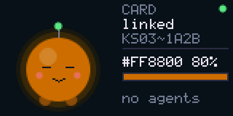

# KS light bridge

A physical "a Claude needs you" light that crosses the machine boundary.
Claude Code sessions on locked-down cloud devboxes signal through RDP to a
USB dongle on your laptop, which drives a KS Bluetooth LED strip and a little
screen creature named Lumi.

```
devbox(es)                  RDP                    your laptop                 Bluetooth
Claude Code hook ─► ks.py ─► smart card redirect ─► ESP32-S3 dongle (T-Dongle) ─► KS strip
                          └► or audio redirect  ─►   screen + LED + button
```



## Two firmwares, pick one

| | `firmware/card` (smart card) | `firmware/audio` (USB speaker) |
| --- | --- | --- |
| Dongle shows up as | CCID smart card reader | speaker "KS Light Bridge" |
| Direction | **two-way**: `ks.py` gets "delivered ✓" or a real error | one-way |
| Several devboxes | serialised by Windows' smart card service | 4 tone channels; simultaneous sends survive (see below) |
| Needs | smart card redirection allowed for your RDP sessions | audio redirection (almost never blocked) |
| Downside | an unusual USB device class on a corp machine | your laptop audio routing; ~2–5 s per command |

`ks.py` auto-detects: it uses the card when it finds a bridge reader, otherwise audio.

**One honest caveat on card mode:** it's a homemade CCID reader. It doesn't
impersonate anything: it has its own ATR, its own proprietary AID, and it answers
"not found" to every other SELECT, including PIV and GIDS. Windows sees an
unknown card and leaves it alone. Still, check it against your device policy
before plugging it into a managed machine.

## What's verified vs not

| Part | Status |
| --- | --- |
| Audio decoder + framing | **Host-tested**: Opus 32/16/12k-voip, AAC, MP3, 0.7% clock error, -45 dB, chime mid-frame, 60 s of junk → 0 false commands. Single channel survives Opus 6 kbps and 6 dB SNR. |
| Simultaneous channels (`test/multichannel.py`) | 1–2 at once: 100% through Opus ≥16k and AAC. 4 at once: 98–100% at Opus ≥24k, 71% at 16k. Opus 12k "voip" mode can't handle overlap. 0 false frames in 2000 decodes. |
| Signal/ack/expiry logic | **Host-tested** (`test/test_logic.c`) |
| Card applet + CCID messages | **Host-tested** with the exact APDUs `ks.py` sends, incl. a Windows-style PIV probe |
| KS packets | Match upstream `golden_packets.json` |
| Screen | Rendered on the host from the same C (`test/ui_preview.py` → `docs/`) |
| Both firmwares | **Build clean** on ESP-IDF v5.4.2 (zero warnings in our code). **Not yet run on hardware.** |
| Board pins | LCD 3/5/4/2/1, backlight 38, LED 40/39 come from LILYGO's own examples. The BOOT button is assumed to be GPIO0. |
| RDP behaviour | Unverified: whether multiple sessions share one redirected reader cleanly, which audio codec/bitrate RDP uses, and per-app audio routing. |

## Bring-up, in order

**0. Host tests** (Linux/WSL with gcc, ffmpeg, numpy, Pillow):
`python3 test/run_tests.py` → `ALL PASSED`.

**1. Bluetooth + screen alone.** Close the KS app on your phone (the strip takes
one connection). Flash the audio firmware in debug mode:

```
cd firmware/audio
idf.py set-target esp32s3
idf.py menuconfig    # KS light bridge -> enable "Debug: skip USB..."
idf.py build flash monitor
```

Expect `found 'KS03~....' -> profile KS03~`, the strip cycling colors, and
every 4th step a fake "demo!" agent asking for you. Lumi goes amber and
bounces. Press **BOOT** to ack: she gets a heart.

**2. Pick a transport** and flash `firmware/card` or `firmware/audio` normally.
After that the USB console is gone (TinyUSB owns the port), so to reflash,
**hold BOOT while plugging in**.

**3. Laptop.**
- *Card:* Windows loads its built-in CCID driver. It may toast that it
  couldn't install a driver for the *card*, which is fine. In your RDP connection
  settings, enable smart card redirection.
- *Audio:* the dongle is a speaker. Route the RDP client's output to it in
  Settings → System → Sound → Volume mixer, rather than making it the system
  default. Untested whether that works per RDP window. Turn off enhancements.

**4. Each devbox.** Copy `host/ks.py` (stdlib only), then:

```
python ks.py status                 # card: shows the lamp and every agent
python ks.py install-hooks          # wire Claude Code to the light (idempotent)
python ks.py signal needs-you       # try it
python ks.py ack
```

Set `KS_SOURCE=name` to choose how a devbox appears on the screen (default:
hostname, 8 chars). For audio, set `KS_CHANNEL=0..3` so each devbox gets
its own channel. The default is a hash of the name, which can collide.

## Agents → light

`install-hooks` adds async hooks to `~/.claude/settings.json`:

| Claude Code event | signal | strip | screen |
| --- | --- | --- | --- |
| `Notification` (`permission_prompt`, `idle_prompt`) | needs-you | pulsing amber (yellow breathing on KS03~) | amber border, `!`, name in amber |
| `UserPromptSubmit` | working | unchanged | blue badge |
| `Stop` | done | green, clears after 2 min | green badge |
| `StopFailure` | error | red until acked | red badge, frown |
| `SessionEnd` | idle | badge removed | |

The most urgent unacknowledged signal wins. It overlays whatever color you set
by hand, and the strip returns to your color when everything is acked or clear.
**BOOT button** or `ks.py ack` acknowledges all. A Claude asking *again* re-alerts;
re-sending the same error doesn't. Up to 8 devboxes are tracked; quiet ones
are evicted first.

## Lumi

Lumi glows whatever the strip is showing. She bounces with sparkles when a
command lands and wobbles with a `!` when someone needs you. She frowns at
errors or garbled input, gets a heart when you ack, sleeps (`z`) when the lamp
is off, and looks around while searching. The antenna is blue while searching,
green when linked, and amber or red for alerts. The right side lists the agents,
most urgent first.

## Wire formats

**Command body**: `[0x5<<4 | op] [args]`, shared by both transports.

| op | args |
| --- | --- |
| 1 power | on (0/1) |
| 2 rgb | r, g, b, brightness 0–100 |
| 3 effect | id 0x82–0x8A, speed 0–100, brightness 1–100 |
| 4 white | level 0–255 |
| 5 signal | source id (crc8 of name), state 0–4, name (0–8 ASCII) |
| 6 ack | — |

**Audio**: body + CRC-8 (poly 0x07), one tone pair per nibble (50 ms tone,
30 ms gap), and a frame ends after ≥150 ms of no tones. Tones sit on an 85 Hz
grid from 600 Hz. Channel *c* owns slots *c, c+4, …, c+28*, so its four row
and four column tones are 340 Hz apart and interleave with the other
channels. Each command is sent twice with a random 300–900 ms gap.

**Card**: AID `F0 4B 53 4C 49 47 48 54` ("·KSLIGHT"). `80 10 00 00 Lc body`
→ 2-byte generation + `9000`. `80 20 00 00 00` → status record (layout in
`ksc_card.h`). `ks.py` wraps SELECT + command in one PC/SC transaction so
other devboxes' sessions can't interleave, then polls status until the
reconcile task has applied that generation.

**Lamp**: packets from [H4ch1Net/ks-led-controller](https://github.com/H4ch1Net/ks-led-controller)
(MIT). Upstream's timing is kept: power-on before color, a 300 ms settle after
connect, and 100 ms between writes. The firmware reconciles a model rather than
replaying commands, so a dropped link heals itself by re-applying the current state.

## Layout

```
host/ks.py                        devbox CLI + hook installer (stdlib only)
firmware/components/kscore/       portable C: audio rx, frames, KS packets,
                                  signal logic, CCID + applet, screen renderer
firmware/components/ksbridge/     ESP glue: BLE central, reconcile task, LCD/LED/button
firmware/components/st7735/       LILYGO's ST7735 driver (MIT, vendored)
firmware/audio/  firmware/card/   the two apps
test/                             run_tests.py, multichannel.py, ui_preview.py, C harnesses
```
